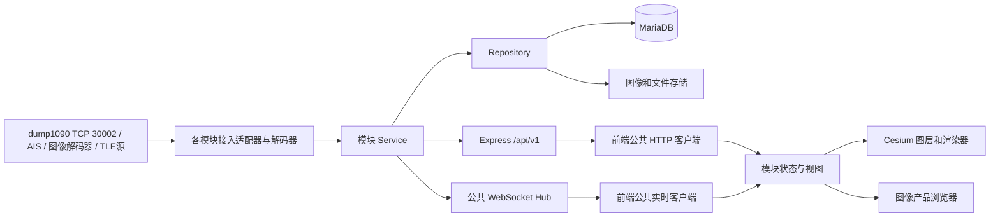

# 无线电监视平台架构

## 范围和现状

保留 Vue 2 与 Cesium，建立 Express 模块化后端。当前实现 ADS-B 工作台、数据库连接与资料查询、可切换底图；AIS、SSTV、气象卫星和轨道模块拥有明确的扩展入口。尚未接入的模块显示未接入，不模拟已经存在的接收数据。

接收机与射频解调程序是外部数据源。Express 不承担 SDR 采样或 DSP；ADS-B 模块在后端完成 dump1090 30002 原始 Mode-S 报文的协议解码。TCP 连接、分帧、解码、目标状态、数据库与推送各自封装；以后加入 AIS、图像或轨道输入时复用基础设施。

## 组件关系

## 后端边界

使用 `app` / `server` 分离：应用可在测试中装配，监听与关停只在入口发生。公共层提供配置、连接池、参数校验、HTTP 请求超时、请求 ID、统一错误和响应。业务模块按目录独立管理 Route / Service / Repository / Adapter。

模块描述统一包含 `id`、`label`、`kind`、`status`、`endpoints`；通过注册表挂载 API，前端按能力识别已配置的数据源。配置为空、数据不可用、源停滞分别有实际状态，不能用 HTTP 200 冒充持续接收。

数据库凭据只存在后端未提交的 `.env`。池按需创建连接；数据库未配置或暂时不可用不阻止界面和其他模块启动。所有查询使用参数，表名/列名只来自经过验证的服务端配置。幂等迁移创建接收源配置 `signal_sources` 和迁移记录 `rs_schema_migrations`，不修改用户导入的表。配置保存成功后才切换连接，重启自动恢复；无记录时不会自动连接假定的接收机。

现阶段 ADS-B 导入表可能是航空器资料表，也可能是观测表；其结构尚未知。先提供只读列结构检查和字段映射。实时位置由后端 TCP 解码器维护，资料表用于登记号、机型、厂商和运营商补充。目标内存有 TTL 和容量限制，断开清理；暂不逐报文存历史。若用户需要历史位置，新增 observation Repository 与保留策略。

## 前端边界

- `config/endpoints`：从前端环境配置统一读取 HTTP、WebSocket 地址与超时；地图地址由 `services/map/map-config` 读取。配置字段见 [环境配置](environment.md)。页面仅显示真实数据，未配置或断线时保持空列表。
- `services/http`：响应解析、超时、取消与错误信息，支持平台响应封装及 dump1090 旧格式。
- `services/polling`：不重叠的轮询、停止、切换时忽略旧结果；各模块共用。
- `services/realtime`：WebSocket、重连退避、消息超时与旧连接隔离；按事件类型交给模块适配器。WebSocket 已连接与 TCP 正在接收有效报文分别呈现。
- `modules/registry`：模块描述和视图入口。新模块有自己的适配与视图，不把所有分支塞进工作台。
- `services/map`：Cesium 加载、底图提供者和图层生命周期；异步选择不会覆盖新选择，卸载会清理。
- 目标规范与渲染器：飞机、船舶、卫星保留类型与原始单位，地理位置统一 WGS 84，渲染器决定图标/高度/航迹。图像产品没有地理范围时只进入图库，有明确范围才叠加到地图。

界面采用紧凑的传统桌面监控台，减少装饰副标题与卡片。顶部提供工作区与数据接入导航，左侧选择业务域和功能，地图和对应列表/详情位于中心，底部提供服务、数据库及接收状态。

## 数据契约与单位

目标观测建议使用 `{ id, module, sourceId, observedAt, position: { longitude, latitude, altitudeMeters }, motion: { speedMetersPerSecond, courseDegrees }, attributes, raw }`。未知值使用 `null`，不要补零；时间为 UTC ISO 8601，位置保持 WGS 84。ADS-B 原始字段仍保留 ft/kt，显示和存储统一单位时必须显式转换。

图像产品建议使用 `{ id, module, stationId, capturedAt, receivedAt, mimeType, width, height, assetUrl, thumbnailUrl, footprint, metadata }`。文件系统/对象存储保存图像，MariaDB 保存索引与元数据。assetUrl 为平台资源地址；服务端校验路径，不接受任意本机文件路径。

轨道元素建议使用 `{ noradId, name, format, epoch, line1, line2, importedAt, source }`；传播结果包含时间点和 ECEF/地理坐标，过境包含 AOS、LOS、最大仰角和对应时刻。TLE/OMM 与接收站坐标决定计算，不在没有轨道数据时编造轨迹。TLE 的新鲜度与预测误差必须随结果呈现。

## 模块扩展路线

| 模块 | 外部接入 | 存储职责 | 前端职责 |
| --- | --- | --- | --- |
| ADS-B | dump1090 30002 TCP AVR，后端 CRC/CPR 解码 | 接收源配置、航空器资料；历史观测按需扩展 | WebSocket 目标、航迹、详情 |
| AIS | 解码后的 JSON / NMEA 适配器 | MMSI 静态资料、动态观测 | 船舶、航迹、航行状态 |
| SSTV | 解码程序完成事件与图像文件 | 产品索引、接收元数据 | 图库、接收时间、原图 |
| 气象卫星 | 图像/遥感产品与地理定位信息 | 文件、波段、范围、产品索引 | 图库、时间选择、地理叠加 |
| 卫星轨道 | TLE / OMM 文件或受控数据源 | 元素集版本、接收站、预测缓存 | 轨道、地面星下点、过境计划 |

新增模块时：定义数据模型 → 实现输入 Adapter → 实现 Service/Repository → 注册 Route 和能力描述 → 添加前端模块/图层渲染器 → 验证输入边界与生命周期。共享代码仅放真实复用的请求、数据库、时间/单位与地图方法，不建立过度抽象的万能 Service。

## 地图

Google 卫星图通过官方 Map Tiles API：后端保存 Key，创建和复用会话，代理显示所需瓦片并提供视口版权信息。Key 不进入前端响应。前端显示 Google 标识和动态归属信息；不预下载、持久化或离线缓存 Google 内容。

无 Google Key 时使用 Esri 卫星图；在线源不可访问时使用随 Cesium 发布的 Natural Earth 低精度底图，并明确标识降级。底图与 ADS-B/AIS 等目标图层独立管理。

参考：[Google 卫星瓦片](https://developers.google.com/maps/documentation/tile/satellite)、[视口与归属信息](https://developers.google.com/maps/documentation/tile/2d-tiles-overview)、[Google 展示要求](https://developers.google.com/maps/documentation/tile/policies)、[Express 异步错误处理](https://expressjs.com/en/guide/error-handling/)、[mysql2 连接池](https://sidorares.github.io/node-mysql2/docs)。
